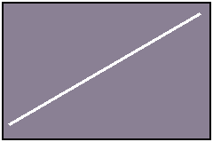
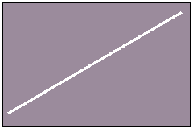
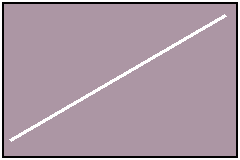
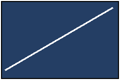
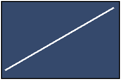
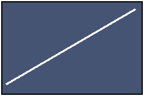

# Public integration sample

## Native objects

Synthetic data only. Inline mathematics: $x+1$, $y^2$, $a/b$, $\alpha+1$ and $\boldsymbol{k}$.

```report-figure
{
  "schema": "report-figure-v1",
  "id": "fig-c6394cd828f7",
  "caption": "Synthetic diagram 1",
  "kind": "image",
  "src": "assets/0000000000000001.png",
  "alt": "Project-owned geometric illustration"
}
```

```report-figure
{
  "schema": "report-figure-v1",
  "id": "fig-public-2",
  "caption": "Synthetic diagram 2",
  "kind": "image",
  "src": "assets/0000000000000002.png",
  "alt": "Project-owned geometric illustration"
}
```

```report-figure
{
  "schema": "report-figure-v1",
  "id": "fig-public-3",
  "caption": "Synthetic diagram 3",
  "kind": "image",
  "src": "assets/0000000000000003.png",
  "alt": "Project-owned geometric illustration"
}
```

```report-figure
{
  "schema": "report-figure-v1",
  "id": "fig-public-4",
  "caption": "Synthetic diagram 4",
  "kind": "image",
  "src": "assets/0000000000000004.png",
  "alt": "Project-owned geometric illustration"
}
```

```report-figure
{
  "schema": "report-figure-v1",
  "id": "fig-public-5",
  "caption": "Synthetic diagram 5",
  "kind": "image",
  "src": "assets/0000000000000005.png",
  "alt": "Project-owned geometric illustration"
}
```

```report-figure
{
  "schema": "report-figure-v1",
  "id": "fig-public-6",
  "caption": "Synthetic diagram 6",
  "kind": "image",
  "src": "assets/0000000000000006.png",
  "alt": "Project-owned geometric illustration"
}
```

```report-figure
{
  "schema": "report-figure-v1",
  "id": "fig-public-7",
  "caption": "Synthetic diagram 7",
  "kind": "image",
  "src": "assets/0000000000000007.png",
  "alt": "Project-owned geometric illustration",
  "sourceAsset": "assets/0000000000000007.emf",
  "rendition": {
    "format": "png",
    "dpi": 144,
    "page": 1,
    "width": 240,
    "height": 160,
    "engine": "synthetic"
  }
}
```

```report-figure
{
  "schema": "report-figure-v1",
  "id": "fig-public-8",
  "caption": "Synthetic diagram 8",
  "kind": "image",
  "src": "assets/0000000000000008.png",
  "alt": "Project-owned geometric illustration",
  "sourceAsset": "assets/0000000000000008.emf",
  "rendition": {
    "format": "png",
    "dpi": 144,
    "page": 1,
    "width": 240,
    "height": 160,
    "engine": "synthetic"
  }
}
```

```report-figure
{
  "schema": "report-figure-v1",
  "id": "fig-public-9",
  "caption": "Synthetic diagram 9",
  "kind": "image",
  "src": "assets/0000000000000009.png",
  "alt": "Project-owned geometric illustration",
  "sourceAsset": "assets/0000000000000009.emf",
  "rendition": {
    "format": "png",
    "dpi": 144,
    "page": 1,
    "width": 240,
    "height": 160,
    "engine": "synthetic"
  }
}
```

| Parameter | Value |
|---|---|
| Length | 1.5 mm |

```report-table
{
  "schema": "report-table-v1",
  "id": "tbl-public-first",
  "caption": "Synthetic parameters",
  "rows": [
    [
      {
        "text": "Parameter",
        "rowspan": 1,
        "colspan": 1
      },
      {
        "text": "Value",
        "rowspan": 1,
        "colspan": 1
      }
    ],
    [
      {
        "text": "Length",
        "rowspan": 1,
        "colspan": 1
      },
      {
        "text": "1.5 mm",
        "rowspan": 1,
        "colspan": 1
      }
    ]
  ]
}
```

```report-table
{
  "schema": "report-table-v1",
  "id": "tbl-deebf0cf6ded",
  "caption": "Synthetic parameters",
  "rows": [
    [
      {
        "text": "Parameter",
        "rowspan": 1,
        "colspan": 1
      },
      {
        "text": "Value",
        "rowspan": 1,
        "colspan": 1
      }
    ],
    [
      {
        "text": "Length",
        "rowspan": 1,
        "colspan": 1
      },
      {
        "text": "1.5 mm",
        "rowspan": 1,
        "colspan": 1
      }
    ]
  ]
}
```

```report-table
{
  "schema": "report-table-v1",
  "id": "tbl-public-last",
  "caption": "Synthetic parameters",
  "rows": [
    [
      {
        "text": "Parameter",
        "rowspan": 1,
        "colspan": 1
      },
      {
        "text": "Value",
        "rowspan": 1,
        "colspan": 1
      }
    ],
    [
      {
        "text": "Length",
        "rowspan": 1,
        "colspan": 1
      },
      {
        "text": "1.5 mm",
        "rowspan": 1,
        "colspan": 1
      }
    ]
  ]
}
```

Reference @fig:fig-c6394cd828f7 and @tbl:tbl-deebf0cf6ded.

<!-- hrs:eq id=eq-public-0 -->
$$
x_0=\frac{1}{2}
$$

<!-- hrs:eq id=eq-public-1 -->
$$
x_1=\frac{1}{2}
$$

<!-- hrs:eq id=eq-public-2 -->
$$
x_2=\frac{1}{2}
$$

<!-- hrs:eq id=eq-public-3 -->
$$
x_3=\frac{1}{2}
$$

<!-- hrs:eq id=eq-c7babca5e6cd -->
$$
x_4=\frac{1}{2}
$$

::: {#fig-4c59dfec6c89 layout-ncol=3 layout-nrow=2 subfig-labels=on}
 {source=assets/0000000000000064.emf format=png dpi=144 width=240 height=160 engine=synthetic}
 {source=assets/0000000000000065.emf format=png dpi=144 width=240 height=160 engine=synthetic}
 {source=assets/0000000000000066.emf format=png dpi=144 width=240 height=160 engine=synthetic}



Synthetic grouped diagrams
:::
